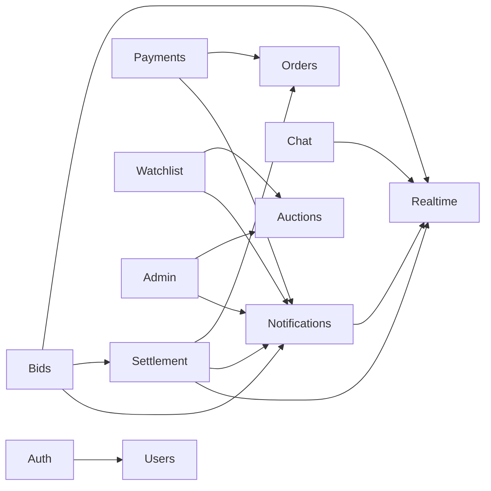
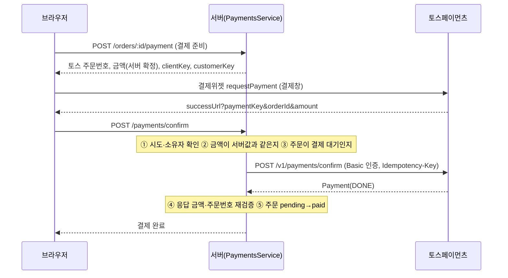

# CODEME — BidVerse 코드 안내

이 문서는 **코드를 읽고 고치려는 개발자**를 위한 안내서입니다.
무엇을 하는 사이트인지, 어떻게 실행하는지는 [README.md](./README.md)를 보세요.

---

## 목차

1. [읽는 순서 추천](#읽는-순서-추천)
2. [전체 구조](#전체-구조)
3. [백엔드 기본 규약](#백엔드-기본-규약)
4. [모듈 지도](#모듈-지도)
5. [핵심 로직 해설](#핵심-로직-해설)
   - [입찰](#입찰-bidsservice)
   - [스나이핑 방지와 즉시구매](#스나이핑-방지와-즉시구매)
   - [정산과 주문](#정산과-주문-settlementservice--ordersservice)
   - [결제](#결제-paymentsservice)
   - [실시간(Socket.IO)](#실시간socketio-bidsgateway)
   - [알림](#알림-notificationsservice)
   - [채팅](#채팅-chatservice)
   - [인증·인가](#인증인가)
   - [속도 제한](#속도-제한)
   - [스케줄러](#스케줄러-3종)
   - [관리자](#관리자-adminservice)
6. [데이터 모델](#데이터-모델)
7. [REST API 목록](#rest-api-목록)
8. [Socket.IO 이벤트](#socketio-이벤트)
9. [프론트엔드](#프론트엔드)
10. [테스트 구조](#테스트-구조)
11. [스크립트](#스크립트)
12. [함정과 설계 결정](#함정과-설계-결정)
13. [새 기능을 추가하는 순서](#새-기능을-추가하는-순서)

---

## 읽는 순서 추천

처음이라면 이 순서로 보면 전체가 잡힙니다.

1. `backend/src/main.ts`, `backend/src/app.module.ts` — 서버가 어떻게 조립되는지
2. `backend/src/bids/bid-queries.ts` → `bids.service.ts` — 이 프로젝트의 핵심인 **동시 입찰 처리**
3. `backend/src/settlement/settlement.service.ts` — 종료된 경매가 주문이 되는 과정
4. `backend/src/payments/payments.service.ts` — 돈이 오가는 부분의 방어 로직
5. `backend/src/bids/bids.gateway.ts` — 실시간 이벤트
6. `frontend/src/pages/AuctionDetail.tsx` + `components/AuctionChat.tsx` — 실시간 화면 처리
7. `backend/test/*.e2e-spec.ts` — "이 기능이 어떻게 동작해야 하는지"를 가장 정확히 보여 주는 문서

---

## 전체 구조

```
bidverse/
├─ backend/
│  ├─ src/
│  │  ├─ main.ts                 부트스트랩 (전역 prefix, 검증 파이프, CORS, trust proxy, Redis 어댑터)
│  │  ├─ app.module.ts           모듈 조립, MongoDB 연결, 속도 제한 설정
│  │  ├─ health.controller.ts    GET /api/health (DB ping)
│  │  ├─ users/                  사용자 스키마/서비스 (+ 인증 가드용 5초 캐시)
│  │  ├─ auth/                   회원가입·로그인·JWT 가드·관리자 가드
│  │  ├─ auctions/               경매 CRUD·목록 검색, 경매 규칙 상수
│  │  ├─ bids/                   입찰·즉시구매, Socket.IO 게이트웨이, 입찰 쿼리 빌더
│  │  ├─ chat/                   경매 채팅
│  │  ├─ settlement/             종료 경매 정산 (낙찰/유찰 확정 + 주문 생성)
│  │  ├─ orders/                 주문 상태 전이 (발송, 수령 확인)
│  │  ├─ payments/               토스 결제 승인·환불·웹훅·대사
│  │  ├─ notifications/          알림 저장 + 실시간 전달
│  │  ├─ watchlist/              관심 경매 + 마감 임박 알림
│  │  ├─ admin/                  관리자 기능, 신고, 감사 로그
│  │  ├─ realtime/               게이트웨이를 여러 모듈이 공유하게 하는 모듈, Redis 어댑터
│  │  ├─ redis/                  Redis 클라이언트, 속도 제한 저장소
│  │  └─ common/                 사용자 기준 속도 제한 가드
│  ├─ test/                      E2E 테스트 + 가짜 토스 서버 + 헬퍼
│  └─ scripts/                   CLI (관리자 지정, DB 점검, 부하 테스트 …)
├─ frontend/src/
│  ├─ main.tsx, App.tsx          진입점, 라우팅, 헤더/푸터
│  ├─ api.ts, auth.tsx           fetch 래퍼, 로그인 상태
│  ├─ socket.tsx, unread.tsx     소켓 연결, 안 읽은 알림 수
│  ├─ Notifications.tsx          실시간 토스트
│  ├─ toss.ts                    토스 결제위젯 SDK 로더/타입
│  ├─ time.ts, types.ts          시간 유틸, 공용 타입
│  ├─ pages/                     화면 (라우트 1개 = 파일 1개)
│  ├─ components/                카드, 채팅, 아이콘, 로고, 공용 UI
│  └─ index.css                  디자인 시스템 (토큰·컴포넌트 스타일 전부)
├─ deploy/nginx/bidverse.conf
└─ ecosystem.config.cjs
```

---

## 백엔드 기본 규약

| 규약 | 내용 |
|---|---|
| **ESM** | `package.json`이 `"type": "module"`입니다. 상대 경로 import는 `./foo.js`처럼 **`.js` 확장자**를 씁니다. (소스는 `.ts`) |
| 전역 prefix | 모든 REST는 `/api`로 시작합니다. (`main.ts`의 `setGlobalPrefix('api')`) |
| 검증 | 요청 본문·쿼리는 `class-validator` DTO로 검증합니다. 전역 `ValidationPipe({ whitelist: true, transform: true })` — DTO에 없는 필드는 버려지고 숫자·날짜는 자동 변환됩니다. |
| 인증 정보 | 컨트롤러에서 `@CurrentUser() user: AuthUser`로 받습니다. `{ id, role, nickname }` |
| 에러 | Nest 기본 예외(`BadRequestException`, `ConflictException` …)를 던지고 **메시지는 사용자에게 보여줄 한국어**입니다. 프론트가 그대로 표시합니다. |
| 서비스 규칙 | 컨트롤러는 얇게(위임만), 규칙과 DB 접근은 서비스에 둡니다. |
| 동시성 | "읽고 판단하고 쓰기" 대신 **조건을 쿼리에 넣은 원자적 업데이트**를 씁니다. (아래 입찰 참고) |
| 멱등성 | 정산·주문 생성·알림 확정은 여러 번 실행돼도 결과가 같게 만들었습니다. |

---

## 모듈 지도

화살표는 "이 모듈이 저 모듈을 가져다 쓴다"입니다.



- **Realtime**은 Socket.IO 게이트웨이(`BidsGateway`) 하나만 제공하고 내보냅니다. 입찰·정산·알림·채팅이 같은 소켓 서버를 쓰게 하려고 분리했습니다.
- **Auth**는 `JwtModule`, `JwtAuthGuard`, `AdminGuard`, `UsersModule`을 다시 내보냅니다. 가드를 쓰는 모든 모듈이 `AuthModule`만 import하면 되도록 하려는 것입니다.
- 순환 의존은 없습니다. (`src/app.module.spec.ts`가 전체 모듈 그래프를 조립해 확인합니다.)

---

## 핵심 로직 해설

### 입찰 (`BidsService`)

**파일**: `backend/src/bids/bid-queries.ts`, `bids.service.ts`

동시에 여러 사람이 입찰해도 가격이 뒤집히면 안 됩니다. 그래서 "경매를 읽어서 → 입찰가를 비교하고 → 저장"하지 않고,
**조건 검사와 갱신을 DB 쿼리 한 번**으로 합니다.

```ts
// bids.service.ts (요약)
const before = await this.auctions.findOneAndUpdate(
  buildBidFilter(auctionId, user.id, amount, now),         // 입찰 가능 조건
  buildBidUpdate(new Types.ObjectId(user.id), amount, now), // 갱신 (집계 파이프라인)
  { returnDocument: 'before', updatePipeline: true },
);
if (!before) throw await this.explainRejection(...);       // 조건에 안 맞으면 아무것도 안 바뀌고 null
```

`buildBidFilter`의 조건:

- 중지되지 않은 경매 (`suspended: { $ne: true }`), 진행 중 (`startsAt <= now < endsAt`)
- 판매자 본인이 아님, 현재 최고가 입찰자 본인이 아님
- 첫 입찰: `currentPrice <= amount` / 이후: `currentPrice + minIncrement <= amount` (`$expr`)

**`before`(갱신 전 문서)를 돌려받는 이유**: 밀려난 이전 최고가 입찰자(`highestBidderId`)와 갱신 전 `bidCount`·`endsAt`을 알아야 알림과 응답을 만들 수 있기 때문입니다. 갱신 후 값은 `amount`와 `before.bidCount + 1`로 계산합니다.

**거절 사유 안내**: 업데이트가 `null`을 돌려주면 그때서야 경매를 한 번 읽어 "종료됨 / 최소 입찰가 미달 / 이미 최고가 …" 중 어느 경우인지 정확한 메시지를 만듭니다. (실패 경로에서만 추가 조회)

**후처리(`finish`)**: 입찰 기록 저장과 밀려난 입찰자 알림을 `Promise.all`로 **동시에** 하고, 그 뒤 `bid:new`를 브로드캐스트합니다. 입찰 기록 저장이 실패해도 입찰 자체는 유효합니다 (경매 문서가 기준) — 한 번 재시도하고 로그를 남깁니다.

> ⚠️ Mongoose 9는 집계 파이프라인(배열) 업데이트에 **`updatePipeline: true` 옵션이 반드시 필요**합니다. 없으면 `Cannot pass an array to query updates` 에러가 납니다. 파이프라인 안의 값은 스키마 캐스팅을 거치지 않으므로 사용자 id는 `ObjectId`로 넘깁니다.

### 스나이핑 방지와 즉시구매

같은 파일(`bid-queries.ts`)에 있습니다.

- **마감 연장**: `buildBidUpdate`의 파이프라인이 `endsAt < now + 5분`이고 `extensionCount < 20`이면 `endsAt`을 `now + 5분`으로, `extensionCount`를 +1로 바꿉니다. 같은 규칙을 앱 쪽 `willExtend()`로도 구현해서 응답의 `extended`와 새 `endsAt`을 계산합니다. 두 구현이 어긋나지 않는지는 `bid-queries.spec.ts`가 검증합니다.
  - 정확히 5분 남았을 때는 연장해도 시간이 늘어나지 않으므로 **연장하지 않습니다** (`<`, `<=` 아님).
- **즉시구매**: `buildBuyNowFilter`(즉시구매가가 있고 `currentPrice < buyNowPrice`)와 `buildBuyNowUpdate`(`currentPrice`를 즉시구매가로, 최고가 입찰자를 구매자로, `endsAt = now`)로 **경매를 그 자리에서 종료**시킵니다. 그 뒤 `SettlementService.settle()`을 바로 호출해 주문까지 만듭니다. (실패해도 스케줄러가 이어받습니다.)

### 정산과 주문 (`SettlementService` + `OrdersService`)

**파일**: `backend/src/settlement/settlement.service.ts`, `backend/src/orders/orders.service.ts`

종료 시각이 지난 경매를 낙찰/유찰로 **확정**하는 단계입니다. 5초마다(`SETTLE_INTERVAL_MS`) `sweep()`이 대상을 찾아 `settle()`을 부릅니다.

`settle(auctionId)`의 순서와 이유:

1. 아직 정산 안 된 경매인지 읽기 (`settledAt: null`, 종료됨, 중지 아님)
2. 낙찰자가 있으면 **주문을 upsert**로 생성 — `auctionId`가 유니크라 몇 번 불려도 주문은 하나
3. `settledAt`을 **조건부로** 기록 (`{ _id, settledAt: null }`) — 이 기록에 성공한 쪽만 다음 단계를 진행
4. `auction:ended` 이벤트와 낙찰/판매/유찰 알림 발송

2번을 3번보다 먼저 하는 이유: 주문 생성 후 서버가 죽어도 다음 스윕이 같은 주문을 upsert하고 마저 확정하기 때문입니다. 반대 순서면 "확정은 됐는데 주문이 없는" 상태가 생길 수 있습니다.

서버가 여러 대여도, 서버가 꺼져 있던 동안 끝난 경매도 안전하게 처리됩니다.

**주문 상태**: `pending → paid → shipped → done`, 그리고 `refunded`

- `OrdersService.advance()`는 **발송(판매자)과 수령 확인(구매자)만** 담당합니다. 현재 상태가 기대한 값일 때만 바뀌도록 조건부 업데이트를 씁니다.
- `pending → paid`(`markPaid`)와 `→ refunded`(`markRefunded`)는 **결제 모듈(`PaymentsService`)만** 호출합니다. 즉 컨트롤러로 "결제 완료"를 직접 찍을 수 있는 경로는 없습니다.
- 주문의 당사자(구매자/판매자)가 아니면 주문이 있는지도 알려 주지 않도록 **404**를 돌려줍니다.

### 결제 (`PaymentsService`)

**파일**: `backend/src/payments/` — `payments.service.ts`(핵심), `toss.client.ts`(토스 API), `payments.config.ts`(모드 결정), `payments-reconcile.service.ts`(대사)



**방어 규칙**

| 위험 | 대응 |
|---|---|
| 클라이언트가 금액을 바꿔 보냄 | 금액은 **서버가 `prepare` 때 정해 저장**합니다. `confirm`에서 클라이언트 값이 다르면 **토스에 승인 요청도 보내지 않고** 거절합니다. 토스 응답의 금액·주문번호도 한 번 더 대조합니다. |
| 같은 승인 요청이 두 번 감 (새로고침, 연타) | 시도 상태가 이미 `done`이면 토스를 다시 부르지 않고 결과를 돌려줍니다. 토스 호출에는 시도 id를 `Idempotency-Key`로 보내 중복 승인을 막습니다. |
| 승인됐는데 응답이 유실됨 | 실패로 단정하지 않고 시도를 `confirming`으로 둡니다. 사용자가 재시도하면 **같은 멱등키**라 중복 결제 없이 완료되고, 사용자가 안 돌아와도 **대사 작업**이 토스에서 조회해 확정합니다. |
| 같은 주문에 이중 결제 | 먼저 반영된 결제만 주문을 `paid`로 만들고, 나중 결제는 **자동 취소**합니다. |
| 위조된 웹훅 | 웹훅 본문은 신뢰하지 않습니다. `orderId`만 뽑아 **우리 시크릿 키로 토스에 다시 조회**한 결과로만 상태를 바꿉니다. 토스는 2xx가 아니면 재전송하므로 처리 중 오류가 나도 항상 200을 돌려줍니다. |
| 키 없이 운영에 배포 | `resolvePaymentsConfig()`가 키 없는 운영 환경을 `off`로 결정해 **결제를 막습니다.** 모의 결제는 `NODE_ENV=production`에서 절대 열리지 않습니다. |
| 추측 가능한 customerKey | 사용자 id를 서버 비밀값으로 HMAC한 값(`bv_…`)을 씁니다. |

**결제 시도(`Payment`) 상태**: `ready`(결제창 열기 전) → `confirming`(승인 요청 후 결과 미확정) → `done`/`waiting`(가상계좌 입금 대기)/`failed`/`canceled`/`expired`

**대사 작업(`PaymentsReconcileService`, 60초마다)**
- 결제는 `done`인데 주문이 아직 `pending`인 건(반영하다 끊김) → 마저 `paid`로
- `confirming`이 2분 넘은 건 → 토스에서 조회해 확정 (토스에 결제가 없으면 `failed`)
- `waiting`이 10분 넘은 건 → 입금 여부 재확인
- `ready`가 24시간 넘은 건 → `expired`

**환불**: 구매자는 `paid` 상태에서만, 관리자는 `paid/shipped/done`에서 전액 환불합니다. 토스 취소 API를 먼저 호출하고(`Idempotency-Key: cancel-<시도id>`), 성공하면 시도를 `canceled`, 주문을 `refunded`로 바꾸고 구매자·판매자에게 알립니다. 토스에서 이미 취소된 결제(`ALREADY_CANCELED_PAYMENT`)는 성공으로 보고 우리 상태만 맞춥니다.

**모드** (`payments.config.ts`)

| 조건 | 모드 | 사용하는 클라이언트 |
|---|---|---|
| `TOSS_CLIENT_KEY`와 `TOSS_SECRET_KEY` 모두 있음 | `toss` | `HttpTossClient` (실제 API) |
| 키 없음, 운영 아님, `PAYMENT_MOCK !== 'false'` | `mock` | `MockTossClient` (메모리 안에서 승인/취소 흉내) |
| 그 외 | `off` | 결제 관련 요청에 503 |

### 실시간(Socket.IO) (`BidsGateway`)

**파일**: `backend/src/bids/bids.gateway.ts`

방(room) 두 종류를 씁니다.

- `auction:{경매id}` — 그 경매를 보고 있는 모두. 입찰·종료·채팅·접속자 수 이벤트가 여기로 갑니다.
- `user:{사용자id}` — 로그인한 사용자 본인. 개인 알림(`notify`)이 여기로 갑니다. 연결 시 `handshake.auth.token`(JWT)을 검증해 넣고, 토큰이 없거나 틀리면 **구경꾼으로만** 연결됩니다.

**입장**: 클라이언트가 `auction:join`을 보내면 방에 넣고 `{ ok, serverTime, viewers }`로 응답합니다. `serverTime`은 클라이언트가 카운트다운을 서버 시각에 맞추는 데 씁니다.

**접속자 수**: 입장·퇴장이 몰려도 방마다 **300ms에 한 번만** `fetchSockets()`로 세서 `auction:viewers`를 보냅니다. Redis 어댑터를 쓰면 `fetchSockets()`가 서버 전체를 합산해 줍니다.

**여러 서버**: `main.ts`가 `REDIS_URL`이 있으면 `RedisIoAdapter`를 붙여 이벤트를 Redis pub/sub으로 전달합니다. 이 경우 클라이언트는 **websocket 전용**으로 연결해야 합니다 (`frontend/src/socket.tsx`) — long-polling은 요청마다 다른 서버로 갈 수 있기 때문입니다.

### 알림 (`NotificationsService`)

**파일**: `backend/src/notifications/notifications.service.ts`

모든 알림은 `notify(userId, event)` 하나로 나갑니다. **DB에 저장한 뒤** 그 id를 붙여 `user:{id}` 방으로 실시간 전송합니다. 알림은 부가 기능이라 **저장이 실패해도 예외를 던지지 않고**(id 없이 실시간 전송만) 입찰·정산 같은 본 흐름을 깨뜨리지 않습니다.

종류: `outbid`, `won`, `sold`, `unsold`, `ending`, `suspended`, `restored`, `paid`, `refunded`. 목록 조회·안 읽은 수·읽음 처리는 `/api/me/notifications`입니다. 읽음 처리 쿼리에는 항상 `userId` 조건이 붙어 남의 알림은 건드릴 수 없습니다.

### 채팅 (`ChatService`)

**파일**: `backend/src/chat/`

- **전송은 REST**(`POST /auctions/:id/chat`)로 받고, 저장 후 `chat:new`를 방에 브로드캐스트합니다. (소켓으로 직접 받지 않는 이유: 인증·검증·속도 제한을 REST 쪽과 똑같이 재사용하기 위해)
- 텍스트는 제어문자를 제거하고 앞뒤 공백을 정리하며 빈 줄은 두 줄까지만 허용합니다. 길이는 **글자 수**(이모지 포함)로 300자까지입니다.
- 종료됐거나 중지된 경매에는 보낼 수 없습니다(읽기 전용). 시작 전 경매는 판매자에게 질문할 수 있게 열려 있습니다.
- 삭제는 **소프트 삭제**(`deletedAt`, `deletedBy` 기록)이고, 작성자·그 경매의 판매자·관리자만 할 수 있습니다. 동시에 두 번 지워도 이벤트는 한 번만 나갑니다.
- 내역 조회는 최근 것부터 `before`(메시지 id) 커서로 읽고, 응답은 **오래된 순**으로 정렬해 돌려줍니다.

### 인증·인가

**파일**: `backend/src/auth/`, `backend/src/users/users.service.ts`

- 로그인/가입은 JWT(`sub`=사용자 id)를 발급합니다. 비밀번호는 `bcryptjs`로 해시합니다.
- **`JwtAuthGuard`**는 토큰 검증 뒤 `UsersService.getAuthSnapshot()`으로 사용자 상태를 확인합니다.
  - 사용자가 없으면 401, **정지(banned)면 403** — 이미 발급된 토큰이어도 막힙니다.
  - 역할(`role`)은 토큰이 아니라 **DB 값**을 씁니다. 권한 변경이 토큰 만료를 기다리지 않습니다.
  - 요청마다 DB를 읽지 않도록 **5초 메모리 캐시**(최대 5000명)를 둡니다. 같은 서버에서 `updateById`로 바꾸면 즉시 무효화되고, 다른 서버나 DB 직접 수정은 최대 5초 뒤 반영됩니다.
- **`AdminGuard`**는 `JwtAuthGuard` 뒤에 붙여 씁니다: `@UseGuards(JwtAuthGuard, AdminGuard)`
- 관리자는 API로 만들 수 없고 `npm run admin:grant`로만 지정합니다.

### 속도 제한

`@nestjs/throttler`를 씁니다. 전역으로 걸지 않고 **라우트마다 명시**합니다. 카운터는 `REDIS_URL`이 있으면 Redis(`RedisThrottlerStorage`, Lua 스크립트로 증가+만료를 원자적으로), 없으면 메모리입니다.

| 대상 | 기준 | 한도 |
|---|---|---|
| 회원가입 | IP | 분당 5회 |
| 로그인 | IP | 분당 10회 |
| 입찰 | 사용자 | 10초에 15회 |
| 즉시구매 | 사용자 | 10초에 5회 |
| 채팅 전송 | 사용자 | 10초에 6회 |
| 신고 | 사용자 | 분당 5회 |
| 결제 준비 / 승인 | 사용자 | 분당 20회 |
| 환불 | 사용자 | 분당 10회 |
| 토스 웹훅 | IP | 분당 120회 |

"사용자 기준"은 `UserThrottlerGuard`(`common/`)가 `JwtAuthGuard` **뒤에서** `req.user.id`로 셉니다. 같은 공유기 뒤의 사용자끼리 서로 막지 않기 위해서입니다. IP 기준이 의미 있으려면 nginx 뒤에서 `TRUST_PROXY=1`이어야 합니다.

### 스케줄러 3종

모두 서버 안의 `setInterval`이고, `onModuleInit`에서 시작하며 `DISABLE_SCHEDULERS=true`면 시작하지 않습니다. 각 스윕은 `running` 플래그로 **겹쳐 실행되지 않고**, 대상을 DB에서 **조건부로 선점**한 쪽만 처리해서 여러 서버가 동시에 돌려도 중복되지 않습니다.

| 서비스 | 주기 | 하는 일 |
|---|---|---|
| `SettlementService` | 5초 | 종료된 경매 정산 |
| `EndingSoonService` | 60초 | 마감 1시간 이내 경매를 관심 등록자에게 알림 (경매당 한 번, `endingSoonNotifiedAt`으로 표시) |
| `PaymentsReconcileService` | 60초 | 결제·주문 상태 대사 |

`ecosystem.config.cjs`는 인스턴스가 여러 개일 때 0번 인스턴스에서만 스케줄러를 켭니다. (중복 조회를 줄이려는 것이고, 안전성은 선점 쿼리가 보장합니다.)

### 관리자 (`AdminService`)

**파일**: `backend/src/admin/`

- 경매 **중지/복구**: 중지된 경매는 공개 목록에서 숨고, 입찰·즉시구매·정산·채팅이 막힙니다. 복구하면 풀리고, 중지 중에 종료됐다면 복구 후 정산됩니다. 판매자에게 알림이 갑니다.
- **신고**: 사용자가 신고(`POST /auctions/:id/report`, 사용자당 경매당 1건)하면 관리자가 `suspend`(경매 중지 + 같은 경매의 다른 신고도 함께 처리) 또는 `dismiss`로 처리합니다.
- **사용자 관리**: 권한 변경, 정지/해제(사유 기록). **본인 계정은 변경할 수 없습니다.**
- 경매 중지·복구, 신고 처리, 사용자 변경은 `AuditLog`에 남습니다. (기록 실패가 이미 끝난 조치를 되돌리지는 않습니다.) **관리자 환불은 결제 모듈을 거치므로 아직 `AuditLog`에는 기록되지 않습니다.** 환불 사유·시각은 `Payment.cancelReason/canceledAt`과 알림에 남습니다.

---

## 데이터 모델

MongoDB 컬렉션(Mongoose 모델)과 주요 인덱스입니다. 참조 ID는 모두 `ObjectId`입니다.

| 모델 | 주요 필드 | 인덱스 / 비고 |
|---|---|---|
| `User` | `email`, `passwordHash`, `nickname`, `role`(`buyer/seller/admin`), `status`(`active/banned`), `bannedReason` | `email`, `nickname` 유니크 |
| `Auction` | `sellerId`, `sellerNickname`, `title`, `description`, `category`, `images[]`, `startPrice`, `currentPrice`, `minIncrement`, `buyNowPrice`, `highestBidderId`, `bidCount`, `startsAt`, `endsAt`, `extensionCount`, `settledAt`, `result`(`sold/unsold`), `suspended`, `suspendedReason`, `endingSoonNotifiedAt` | `sellerId`, `endsAt`, 제목 text, `{settledAt, endsAt}` |
| `Bid` | `auctionId`, `bidderId`, `bidderNickname`, `amount` | `{auctionId, amount:-1}` |
| `Order` | `auctionId`, `title`, `buyerId`, `sellerId`, `finalPrice`, `status`, `paidAt/shippedAt/completedAt/refundedAt` | `auctionId` **유니크** (경매당 주문 1개) |
| `Payment` | `orderId`, `buyerId`, `tossOrderId`, `amount`, `status`, `paymentKey`, `method`, `approvedAt`, `receiptUrl`, `failure`, `orderSyncedAt`, `canceledAt` | `tossOrderId` 유니크, `{status, updatedAt}` |
| `Notification` | `userId`, `type`, `auctionId`, `title`, `amount`, `orderId`, `message`, `readAt` | `{userId, createdAt:-1}`, `{userId, readAt}`, **TTL 90일** |
| `Watch` | `userId`, `auctionId` | `{userId, auctionId}` 유니크 |
| `Report` | `auctionId`, `reporterId`, `reason`, `status`, `resolution`, `note`, `resolvedBy` | `{auctionId, reporterId}` 유니크 |
| `AuditLog` | `adminId`, `action`, `targetType`, `targetId`, `detail` | `createdAt` |
| `ChatMessage` | `auctionId`, `userId`, `nickname`, `text`, `isSeller`, `isAdmin`, `deletedAt`, `deletedBy` | `{auctionId, _id:-1}`, **TTL 90일** |

설계 포인트
- **경매 상태(예정/진행/종료)는 저장하지 않고 시각으로 계산**합니다 (`startsAt`, `endsAt`와 현재 시각). 저장하는 것은 `settledAt`(정산 완료), `result`, `suspended`뿐입니다. 그래서 스케줄러가 늦어도 입찰은 `endsAt` 기준으로 즉시 막힙니다.
- **닉네임을 문서에 함께 저장**(`sellerNickname`, `bidderNickname`, 채팅 `nickname`)해서 조회마다 사용자 컬렉션을 따로 읽지 않습니다. (DB 왕복을 줄이려는 비정규화)
- 유니크 인덱스가 **정합성의 마지막 방어선**입니다 (주문 중복, 관심 중복, 신고 중복, 결제 주문번호 중복).

---

## REST API 목록

모든 경로 앞에 `/api`가 붙습니다. **인증**: 공개 / 로그인(JWT) / 관리자

### 인증
| 메서드 | 경로 | 인증 | 설명 |
|---|---|---|---|
| POST | `/auth/register` | 공개 | 회원가입 → `{ accessToken, user }` |
| POST | `/auth/login` | 공개 | 로그인 |
| GET | `/auth/me` | 로그인 | 내 정보 |

### 경매 · 입찰
| 메서드 | 경로 | 인증 | 설명 |
|---|---|---|---|
| GET | `/auctions` | 공개 | 목록 (`q`, `category`, `status`, `sort`, `sellerId`, `page`, `limit`) |
| GET | `/auctions/:id` | 공개 | 상세 |
| POST | `/auctions` | 로그인 | 등록 |
| PATCH | `/auctions/:id` | 로그인 | 수정 (판매자/관리자, 입찰 전만) |
| DELETE | `/auctions/:id` | 로그인 | 삭제 (입찰 전만) |
| GET | `/auctions/:id/bids` | 공개 | 입찰 내역 (닉네임 마스킹) |
| POST | `/auctions/:id/bids` | 로그인 | 입찰 `{ amount }` |
| POST | `/auctions/:id/buy-now` | 로그인 | 즉시구매 |
| POST | `/auctions/:id/report` | 로그인 | 신고 `{ reason }` |

### 채팅 · 관심 · 알림
| 메서드 | 경로 | 인증 | 설명 |
|---|---|---|---|
| GET | `/auctions/:id/chat` | 공개 | 내역 (`limit`, `before`) → `{ items, hasMore }` |
| POST | `/auctions/:id/chat` | 로그인 | 전송 `{ text }` |
| DELETE | `/auctions/:id/chat/:messageId` | 로그인 | 삭제 (작성자/판매자/관리자) |
| POST / DELETE | `/watchlist/:auctionId` | 로그인 | 관심 담기 / 빼기 |
| GET | `/me/watchlist` | 로그인 | 관심 경매 목록 |
| GET | `/me/watchlist/ids` | 로그인 | 관심 경매 id 목록 |
| GET | `/me/notifications` | 로그인 | 알림 목록 (`page`, `limit`) |
| GET | `/me/notifications/unread-count` | 로그인 | 안 읽은 수 |
| POST | `/me/notifications/read` | 로그인 | 읽음 처리 `{ ids? }` (비우면 전부) |

### 주문 · 결제
| 메서드 | 경로 | 인증 | 설명 |
|---|---|---|---|
| GET | `/me/orders` | 로그인 | 내 주문 (구매·판매, `role` 포함) |
| GET | `/orders/:id` | 로그인 | 주문 상세 (당사자만) |
| POST | `/orders/:id/ship` | 로그인 | 발송 처리 (판매자) |
| POST | `/orders/:id/confirm` | 로그인 | 수령 확인 (구매자) |
| POST | `/orders/:id/payment` | 로그인 | 결제 준비 (구매자) |
| POST | `/payments/confirm` | 로그인 | 결제 승인 `{ paymentKey, orderId, amount }` |
| POST | `/orders/:id/refund` | 로그인 | 환불 `{ reason }` (구매자: 발송 전 / 관리자) |
| POST | `/payments/webhook` | 공개 | 토스 웹훅 |

### 관리자
| 메서드 | 경로 | 설명 |
|---|---|---|
| GET | `/admin/stats` | 통계 |
| GET | `/admin/auctions` | 경매 목록 (중지된 경매 포함, `suspended=true`로 필터) |
| POST | `/admin/auctions/:id/suspend` · `/restore` | 중지 `{ reason }` / 복구 |
| GET | `/admin/orders` | 주문 목록 (`status`) |
| POST | `/admin/orders/:id/refund` | 관리자 환불 |
| GET | `/admin/users` · PATCH `/admin/users/:id` | 사용자 검색 / 권한·정지 변경 |
| GET | `/admin/reports` · POST `/admin/reports/:id/resolve` | 신고 목록 / 처리 `{ action, note? }` |
| GET | `/admin/audit` | 감사 로그 |

### 기타
| 메서드 | 경로 | 설명 |
|---|---|---|
| GET | `/health` | 상태 확인 (DB ping) |
| GET | `/` | 서버 동작 확인용 기본 응답 |

---

## Socket.IO 이벤트

연결: `io({ transports: ['websocket'], auth: { token } })` — 토큰은 선택입니다.

| 방향 | 이벤트 | 페이로드 | 설명 |
|---|---|---|---|
| 클라이언트 → 서버 | `auction:join` | `{ auctionId }` | 경매방 입장. 응답: `{ ok, serverTime, viewers? }` |
| 클라이언트 → 서버 | `auction:leave` | `{ auctionId }` | 경매방 퇴장 |
| 서버 → 방 | `bid:new` | `{ auctionId, bid, currentPrice, bidCount, minNextBid, highestBidderId, endsAt, extended }` | 새 입찰 |
| 서버 → 방 | `auction:ended` | `{ auctionId, result, winner?, finalPrice? }` | 정산 완료 |
| 서버 → 방 | `chat:new` | `{ id, auctionId, userId, nickname, text, isSeller, isAdmin, createdAt }` | 새 채팅 |
| 서버 → 방 | `chat:deleted` | `{ auctionId, messageId }` | 채팅 삭제 |
| 서버 → 방 | `auction:viewers` | `{ auctionId, count }` | 접속자 수 |
| 서버 → 개인 | `notify` | `{ type, auctionId, title, amount?, orderId?, message?, id?, createdAt? }` | 개인 알림 |

---

## 프론트엔드

### 구조와 상태 관리

외부 상태 관리 라이브러리 없이 **React Context 3개**와 컴포넌트 상태로 충분합니다.

| Context | 파일 | 역할 |
|---|---|---|
| `AuthProvider` / `useAuth` | `auth.tsx` | 로그인 사용자, `login/register/logout`. 토큰은 `localStorage`의 `bidverse.token` |
| `SocketProvider` / `useSocket` | `socket.tsx` | 소켓 1개. 로그인 사용자가 바뀌면 새로 연결해 개인 알림 방이 올바른 사용자로 잡히게 함 |
| `UnreadProvider` / `useUnread` | `unread.tsx` | 헤더의 안 읽은 알림 수. `notify` 이벤트로 증가 |

- `api.ts`의 `api<T>(path, { method, json })`가 `/api` 호출, 토큰 헤더, 에러 메시지 추출(`ApiError`)을 맡습니다. 서버의 한국어 에러 메시지가 그대로 화면에 뜹니다.
- 개발 서버는 Vite 프록시가 `/api`, `/socket.io`를 `localhost:3000`으로 넘기고, 운영에서는 nginx가 같은 일을 합니다. (그래서 CORS가 필요 없습니다.)

### 라우트와 화면

| 경로 | 파일 | 접근 |
|---|---|---|
| `/` | `pages/AuctionList.tsx` | 공개 — 히어로, 검색, 카테고리·상태·정렬 필터. 기본 탭은 "진행 중" |
| `/auctions/:id` | `pages/AuctionDetail.tsx` | 공개 — 갤러리, 입찰, 즉시구매, **채팅**, 입찰 내역 |
| `/auctions/new`, `/auctions/:id/edit` | `pages/AuctionForm.tsx` | 로그인 |
| `/login`, `/register` | `pages/AuthPage.tsx` | 공개 |
| `/orders` | `pages/Orders.tsx` | 로그인 — 주문과 진행 스텝퍼 |
| `/orders/:id/pay` | `pages/CheckoutPage.tsx` | 로그인 — 토스 결제위젯 / 모의 결제 |
| `/payments/success`, `/payments/fail` | `pages/PaymentResultPage.tsx` | 로그인 — 토스 리다이렉트 도착 지점 |
| `/watchlist` | `pages/WatchlistPage.tsx` | 로그인 |
| `/notifications` | `pages/NotificationsPage.tsx` | 로그인 |
| `/admin` | `pages/AdminPage.tsx` | 관리자 (탭: 신고/경매/주문·환불/사용자/감사 로그) |

접근 제한은 `App.tsx`의 `RequireAuth`가 처리합니다 (`admin` 속성이면 관리자만).

### 실시간 화면 처리 패턴 (`AuctionDetail.tsx`)

- 입장 시 `auction:join` → 응답의 `serverTime`으로 **서버 시각 오차(`clockOffset`)** 를 계산해 카운트다운에 반영합니다.
- 입찰 성공 응답(REST)과 `bid:new`(소켓)가 **같은 `applyUpdate()`** 로 들어옵니다. 오래된 갱신이 최신 값을 덮지 않도록 `bidCount`가 더 클 때만 반영하고, 입찰 내역은 id로 중복을 제거합니다.
- 연결이 끊겼다가 `reconnect`되면 REST로 다시 불러와 그 사이 놓친 입찰을 보충합니다.
- `status`(예정/진행/종료)는 서버가 준 값이 아니라 **`serverNow`와 `startsAt/endsAt` 비교로 매초 계산**해서, 마감 순간에 화면이 바로 바뀝니다.

### 채팅 컴포넌트 (`components/AuctionChat.tsx`)

- 메시지와 **시스템 줄**(입찰·마감 연장 알림)을 시간순으로 합쳐 한 목록으로 그립니다. REST 응답과 소켓 이벤트가 겹쳐 와도 id로 한 번만 보입니다.
- 맨 아래를 보고 있으면 새 메시지를 따라 내려가고, 위로 올려 읽는 중이면 따라가지 않고 "새 메시지 N개 ↓" 버튼을 보여 줍니다. 이전 메시지를 위에 붙일 때는 스크롤 위치를 유지합니다.
- Enter 전송 / Shift+Enter 줄바꿈이며, **한글 조합 중(`isComposing`)의 Enter는 전송하지 않습니다.**
- 같은 사람이 5분 안에 연달아 보낸 메시지는 이름·아바타를 한 번만 보여 줍니다.

### 결제 화면 (`toss.ts`, `CheckoutPage.tsx`)

`toss.ts`가 SDK(`https://js.tosspayments.com/v2/standard`)를 한 번만 불러옵니다. `CheckoutPage`는 서버가 준 주문번호·금액으로 위젯을 그립니다. **화면에 보이는 금액도 서버 응답 그대로**입니다. 결제 버튼은 토스 결제창으로 이동시키고, 돌아오는 `/payments/success`가 쿼리의 `paymentKey/orderId/amount`를 서버에 넘겨 승인합니다. (금액은 서버가 저장한 값과 대조하므로 쿼리를 바꿔도 소용없습니다. React StrictMode의 이중 실행으로 승인을 두 번 보내지 않도록 `useRef`로 막습니다.)

### 디자인 시스템 (`index.css`)

- 한 파일 안에 **토큰(CSS 변수) → 기본 → 레이아웃 → 버튼/폼 → 카드/배지 → 홈 → 상세 → 인증 → 주문·알림·관리자 → 반응형** 순서로 정리되어 있습니다.
- 색상·간격·그림자는 `:root`의 변수로 정의하고, 다크 모드는 같은 변수를 `prefers-color-scheme: dark`와 `[data-theme='dark']`에서 다시 정의합니다. (`ThemeToggle`이 `data-theme`와 `localStorage.bidverse.theme`을 관리하고, `index.html`의 짧은 스크립트가 첫 페인트 전에 적용해 깜빡임을 막습니다.)
- 아이콘은 라이브러리 없이 `components/Icon.tsx`의 인라인 SVG 경로로 그립니다.
- 같은 클래스 이름을 재사용하는 방식입니다. 새 화면을 만들 때는 `card`, `badge`, `price`, `btn-block`, `grid` 같은 기존 클래스를 먼저 쓰세요.

---

## 테스트 구조

| 종류 | 위치 | 실행 | 특징 |
|---|---|---|---|
| 단위 | `backend/src/**/*.spec.ts` | `npm test` | DB·Redis 없이 동작. 서비스는 모의 모델로, 가드·설정·쿼리 빌더는 순수 함수로 검증 |
| E2E | `backend/test/*.e2e-spec.ts` | `npm run test:e2e` | **실제 MongoDB**에 임시 DB를 만들어 앱 전체를 띄우고 실제 HTTP/WebSocket으로 시나리오 실행 |
| 부하 | `backend/scripts/load-test.mjs` | `npm run load-test` | 실제 서버 프로세스에 동시 입찰을 퍼붓고 DB에서 불변식 검사 |

**단위 테스트에서 눈여겨볼 것**
- `bid-queries.spec.ts` — 입찰 필터·파이프라인을 `mingo`(JS 구현 MongoDB 질의 엔진)로 직접 실행해 연장 경계값(정확히 5분, 1ms 짧게, 상한 20회)을 검증
- `schemas.spec.ts` — 모든 `ref` 필드가 `ObjectId`인지 확인 (아래 함정 참고)
- `app.module.spec.ts` — 전체 모듈을 가짜 DB 연결로 조립해 의존성 그래프를 확인
- `redis.spec.ts` — `ioredis-mock`으로 속도 제한 Lua 로직과 인스턴스 간 소켓 이벤트 전달 확인
- `bids.gateway.spec.ts` — 실제 Socket.IO 클라이언트로 방 격리·접속자 수 확인

**E2E 구성**
- `test/helpers.ts`의 `startApp()`이 임시 DB 이름(`bidverse_e2e_*`)을 만들고 스케줄러·속도 제한을 끈 채 앱을 띄웁니다. 테스트가 `sweep()`을 직접 불러 시점을 통제합니다. 종료 시각은 DB를 직접 수정해 과거로 돌립니다.
- `test/fake-toss.ts`는 토스 API 모양의 로컬 HTTP 서버입니다. 인증 헤더 검증, `Idempotency-Key` 중복 응답, 승인 후 응답 유실, 가상계좌, 외부 취소 같은 상황을 흉내 냅니다.
- 종료 시에는 접두사(`bidverse_e2e_`)를 확인한 뒤에만 DB를 지웁니다.

**부하 테스트가 검사하는 불변식**: 성공한 입찰 수 = `bidCount` = `bids` 문서 수 / 최종가 = 성공한 입찰 중 최대 금액 / 성공 금액 정렬 시 연속한 값의 차이가 항상 최소 입찰 단위 이상 / 상회 입찰 알림 수 = 성공 수 − 1 / 모든 구경꾼이 `bid:new`를 빠짐없이 수신 / 정산이 주문을 정확히 하나 생성 / 5xx와 서버 ERROR 로그 0건

---

## 스크립트

`backend/scripts/` — 모두 `backend/.env`의 `MONGODB_URI`를 쓰고, 접속 문자열은 출력하지 않습니다.

| 파일 | 설명 |
|---|---|
| `grant-admin.mjs` | 관리자 지정/회수 (`npm run admin:grant`, `admin:revoke`) |
| `db-check.mjs` | 연결·버전·레플리카셋·쓰기 권한 점검 (`npm run db:check`) |
| `db-clean-temp.mjs` | `bidverse_e2e_/load_/check_` 접두사 임시 DB 정리 (`npm run db:clean-temp`) |
| `db-rtt.mjs` | DB 왕복 지연 측정 |
| `db-throughput.mjs` | DB 초당 처리량 측정 (무료 티어 제한 확인용) |
| `load-test.mjs` | 부하 테스트 (`npm run load-test`, 환경변수 `LOAD_BIDDERS`, `LOAD_SECONDS`, `LOAD_WATCHERS`, `LOAD_PORT`) |

---

## 함정과 설계 결정

실제로 겪었거나 일부러 선택한 것들입니다. 코드를 고치기 전에 한 번 읽어 두세요.

1. **참조 ID는 `Schema.Types.ObjectId`** — `@Prop({ type: Types.ObjectId })`(값 클래스)로 쓰면 Mongoose 9가 필드를 `Mixed`로 잡습니다. 저장은 되지만 문자열↔ObjectId 캐스팅이 안 돼서 조회가 조용히 빗나갑니다. `import { Schema as MongooseSchema } from 'mongoose'` 후 `MongooseSchema.Types.ObjectId`를 쓰세요.
2. **집계 파이프라인 업데이트에는 `updatePipeline: true`** — 없으면 Mongoose 9가 거부합니다.
3. **`start:dev` 중에 `npm run build` 금지** — `nest-cli.json`의 `deleteOutDir`로 `dist`가 지워져 watch 중인 서버가 죽습니다.
4. **정확히 5분 남았을 때는 연장하지 않음** — 연장해도 마감이 늘지 않는데 연장 횟수만 올라가는 것을 막으려고 `<`를 씁니다.
5. **정산은 주문 생성 → 확정 순서** — 반대로 하면 "확정됐는데 주문이 없는" 상태가 생길 수 있습니다.
6. **결제 반영은 오직 PaymentsService만** — `OrdersService`에는 결제 단계로 직접 전이하는 메서드가 없습니다. 모의 결제도 같은 `confirm` 경로를 탑니다.
7. **운영에서 키 없으면 결제 차단** — 모의 결제가 운영에서 열리면 공짜로 결제 완료가 됩니다.
8. **인증 캐시 5초** — DB를 직접 고치면(예: 테스트에서 역할 변경) 최대 5초 뒤에 반영됩니다. 테스트는 첫 요청 전에 바꾸거나 새 사용자로 확인합니다.
9. **입찰 내역은 닉네임 마스킹, 채팅은 그대로** — 입찰 익명성과 대화 편의를 맞바꾼 결정입니다. 바꾸려면 `ChatService`의 응답 매핑만 고치면 됩니다.
10. **서버가 여러 대면 websocket 전용** — long-polling은 sticky session 없이는 끊깁니다. 프론트 `socket.tsx`의 `transports: ['websocket']`을 유지하세요.
11. **ESM `.js` 확장자** — 상대 경로 import에서 빠뜨리면 런타임에 모듈을 못 찾습니다. (타입 검사는 통과해도 실행이 안 됩니다.)
12. **한글 줄바꿈** — `index.css`의 `body { word-break: keep-all }`로 단어 중간에서 끊기지 않게 합니다. 채팅 말풍선만 긴 문자열을 위해 `overflow-wrap: anywhere`를 씁니다.
13. **모바일 `flex-wrap: wrap`인 세로 flex** — 줄 너비가 가장 긴 자식에 맞춰져 가로로 넘칩니다. 모바일 툴바는 `nowrap`으로 되어 있습니다.

---

## 새 기능을 추가하는 순서

백엔드에 새 도메인(예: "리뷰")을 추가한다면:

1. **스키마** — `reviews/review.schema.ts`. 참조 ID는 `MongooseSchema.Types.ObjectId`. 중복을 막아야 하면 유니크 인덱스, 조회 패턴에 맞는 인덱스, 필요하면 TTL.
2. **DTO** — `class-validator`로 입력 검증. 메시지는 한국어.
3. **서비스** — 규칙과 DB 접근. 경합이 생길 수 있으면 조건을 쿼리에 넣은 원자적 업데이트로. 실패 사유를 사용자 언어로 던지기.
4. **컨트롤러** — `@UseGuards(JwtAuthGuard)`(관리자면 `AdminGuard`도), 남용될 수 있는 쓰기 API는 `@Throttle` + `UserThrottlerGuard`.
5. **모듈** — `MongooseModule.forFeature`, `AuthModule` import(가드용), 실시간이 필요하면 `RealtimeModule`, 알림이 필요하면 `NotificationsModule`. `AppModule`에 등록.
6. **테스트** — 서비스 단위 테스트(경계값·권한·실패 경로) + 실제 DB E2E 시나리오(`test/`). `src/schemas.spec.ts`의 클래스 목록에 새 스키마를 추가.
7. **프론트** — `types.ts`에 타입, 페이지는 `pages/`, 라우트는 `App.tsx`(로그인 필요하면 `RequireAuth`). 스타일은 기존 `index.css` 클래스를 먼저 재사용.
8. **문서** — 이 파일의 API 표와 데이터 모델 표 갱신.

새 알림 종류를 추가한다면 `notification.schema.ts`의 `NOTIFICATION_TYPES`, `bids.gateway.ts`의 `NotifyEvent`, 프론트 `types.ts`의 `NotifyType`과 `describeNotification()`, `Notifications.tsx`의 아이콘·링크 매핑을 함께 고칩니다.
